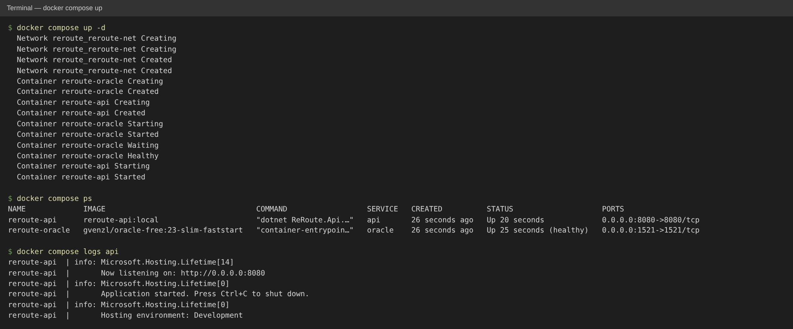
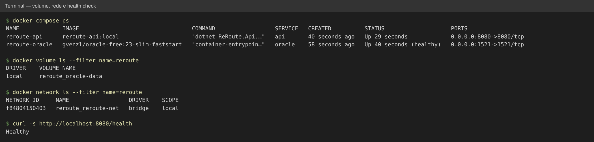
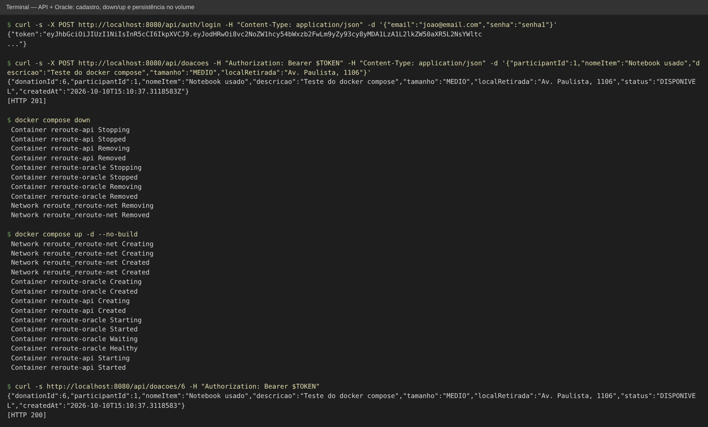
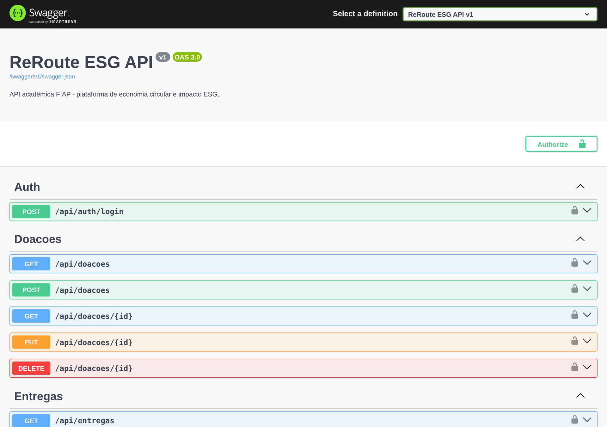
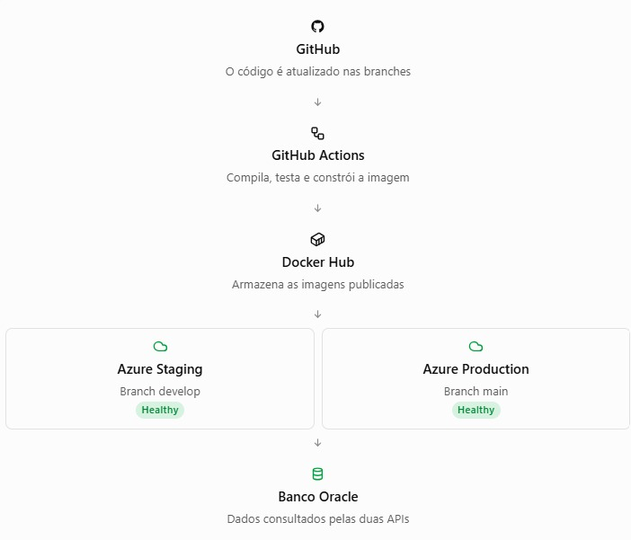
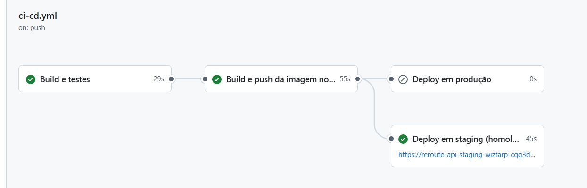
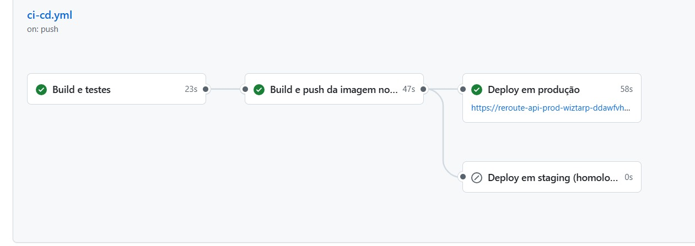
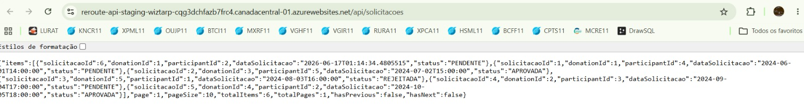
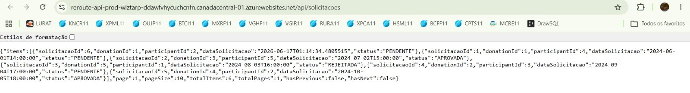
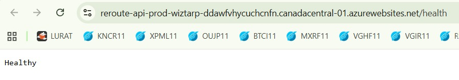

# Projeto - ReRoute

Projeto **ReRoute**: API REST em ASP.NET Core 8 para uma plataforma de economia circular. A ideia é conectar doadores, receptores e transportadores em um fluxo de doação e registrar o impacto ambiental (ESG) de cada doação.

**Fluxo:** Doação → Solicitação → Entrega → Registro ESG

## Integrantes

| Nome | RM |
| --- | --- |
| Daphne Victoria Pollini Amadeu | RM562717 |
| Paula Cardoso da Cruz | RM562406 |
| Kenny Lemes Brisola | RM564336 |

---

## Como executar localmente com Docker

O `docker-compose.yml` sobe a API e um banco **Oracle** local (imagem `gvenzl/oracle-free`, Oracle Database 23 Free), então não precisa do Oracle da FIAP nem do .NET instalado. Só é preciso ter o **Docker** com o **Docker Compose** (Docker Desktop no Windows/macOS).

1. Copie o arquivo de variáveis e troque as senhas:

```bash
cp .env.example .env
```

No PowerShell: `Copy-Item .env.example .env`

Edite o `.env` e preencha pelo menos `ORACLE_PASSWORD`, `DB_PASSWORD` e `JWT_SECRET_KEY` (mínimo de 32 caracteres). O `.env` está no `.gitignore` e não vai para o GitHub.

2. Suba os containers:

```bash
docker compose up -d --build
```

Na primeira vez o Docker baixa as imagens (o Oracle tem cerca de 1 GB) e compila a API. O container da API só inicia depois que o banco fica `healthy`; ao iniciar, a API aplica as migrations do EF Core e cria os dados de exemplo.

3. Confira se está tudo rodando:

```bash
docker compose ps
docker compose logs -f api
```

4. Acesse:

- Swagger: <http://localhost:8080/swagger>
- Health check: <http://localhost:8080/health> (responde `Healthy`)
- Banco (opcional, por SQL Developer/DBeaver): `localhost:1521/FREEPDB1`, usuário `DB_USER` e senha `DB_PASSWORD` do `.env`

5. Teste rápido com `curl`:

```bash
# login (devolve o token JWT)
curl -s -X POST http://localhost:8080/api/auth/login \
  -H "Content-Type: application/json" \
  -d '{"email":"joao@email.com","senha":"senha1"}'

# listar doações usando o token
curl -s http://localhost:8080/api/doacoes -H "Authorization: Bearer <token>"
```

Usuários de exemplo criados pelo seed: `joao@email.com` / `senha1` (DOADOR), `maria@email.com` / `senha2` (RECEPTOR), `carlos@email.com` / `senha3` (TRANSPORTADOR).

6. Para parar:

```bash
docker compose down      # para e remove os containers e a rede; os dados continuam no volume
docker compose down -v   # remove também o volume (apaga o banco e o seed roda de novo)
```

### Sem Docker (.NET 8 SDK)

Também dá para rodar a API direto com o .NET 8 SDK, apontando para o Oracle da FIAP. Defina as variáveis no terminal:

```bash
export OracleConnection__ConnectionString="User Id=SEU_RM;Password=SUA_SENHA;Data Source=oracle.fiap.com.br:1521/ORCL"
export Jwt__SecretKey="uma-chave-com-pelo-menos-32-caracteres"
```

No PowerShell:

```powershell
$env:OracleConnection__ConnectionString="User Id=SEU_RM;Password=SUA_SENHA;Data Source=oracle.fiap.com.br:1521/ORCL"
$env:Jwt__SecretKey="uma-chave-com-pelo-menos-32-caracteres"
```

E rode:

```bash
dotnet restore
dotnet run --project ReRoute.Api
```

O Swagger fica em `http://localhost:5110/swagger` e o health check em `http://localhost:5110/health`.

Para rodar os testes (não precisam de banco, usam EF Core InMemory):

```bash
dotnet test
```

---

## Pipeline CI/CD

### Ferramenta

Usamos o **GitHub Actions**. O workflow fica em `.github/workflows/ci-cd.yml` e roda automaticamente a cada `push` ou `pull request` nas branches `main` e `develop`. A imagem Docker vai para o **Docker Hub** e a aplicação roda no **Azure Web App** (App Service com container Linux), com dois ambientes: **staging (homologação)** e **production**.

### Etapas

O pipeline tem 4 jobs, ligados com `needs` (um só começa se o anterior der certo):

1. **build-test (Build e testes)**
   - faz o checkout do código e instala o .NET 8;
   - faz o `dotnet restore` e o `dotnet build` em modo Release;
   - roda os testes xUnit com `dotnet test` e gera um relatório `.trx`;
   - publica o relatório como artefato (`resultado-testes`), que pode ser baixado na aba Actions.

   Se algum teste falhar, o pipeline para aqui e nada é publicado.

2. **docker (Build e push da imagem no Docker Hub)**
   - só roda em `push` (em pull request apenas build e testes são executados);
   - faz login no Docker Hub com os secrets `DOCKERHUB_USERNAME` e `DOCKERHUB_TOKEN`;
   - gera a imagem a partir do `Dockerfile` da raiz e envia para `<usuario-dockerhub>/reroute-api`;
   - cada imagem recebe duas tags: o SHA do commit (`${{ github.sha }}`, para saber exatamente qual versão está rodando) e o nome do ambiente (`staging` para a `develop` e `latest` para a `main`).

3. **deploy-staging (Deploy em staging/homologação)**
   - roda quando há push na `develop`;
   - usa o environment `staging` do GitHub;
   - usa a action `azure/webapps-deploy@v2` com o publish profile do Web App de staging para trocar a imagem do container pela imagem com a tag do commit;
   - depois testa o endpoint `/health` da aplicação.

4. **deploy-production (Deploy em produção)**
   - roda quando há push na `main`;
   - usa o environment `production` do GitHub;
   - faz o mesmo processo do staging, apontando para o Web App de produção.

### Estratégia de branches

| Branch | O que acontece | Ambiente |
| --- | --- | --- |
| `feature/*` (pull request para `develop`) | só build e testes | nenhum |
| `develop` | build, testes, imagem `:staging` e deploy | staging (homologação) |
| `main` | build, testes, imagem `:latest` e deploy | produção |
| pull request da `develop` para a `main` | só build e testes | nenhum |

O fluxo de trabalho é: cada funcionalidade é feita numa branch `feature/...` criada a partir da `develop`. Quando termina, abrimos um pull request para a `develop`; o pipeline roda build e testes e, se algum teste falhar, o merge não deve ser feito. Depois do merge, a `develop` sobe para staging. Quando a versão está validada em staging, abrimos um pull request da `develop` para a `main`, e o merge faz o deploy em produção.

Na prática isso separa as duas partes do CI/CD:

- **Integração contínua (CI):** todo código novo é compilado e testado automaticamente antes de entrar na `develop`/`main`.
- **Entrega contínua (CD):** depois dos testes, a imagem é gerada e publicada sozinha em staging e em produção. Como o deploy em produção também é automático após o merge na `main`, o nosso fluxo fica mais perto de *implantação contínua* (continuous deployment). Se o environment `production` tiver revisor obrigatório no GitHub (Settings > Environments > Required reviewers), o último passo passa a ser uma aprovação manual, que é o modelo de entrega contínua.

### Secrets e variáveis

Nenhuma senha fica no código. O `appsettings.json` vai com os campos sensíveis vazios e a aplicação lê tudo de variáveis de ambiente (o ASP.NET converte `__` em `:`, então `Jwt__SecretKey` vira `Jwt:SecretKey`).

No GitHub:

| Nome | Onde | Tipo | Para que serve |
| --- | --- | --- | --- |
| `DOCKERHUB_USERNAME` | Settings > Secrets and variables > Actions (repositório) | secret | usuário do Docker Hub |
| `DOCKERHUB_TOKEN` | Settings > Secrets and variables > Actions (repositório) | secret | access token do Docker Hub (não é a senha) |
| `AZURE_WEBAPP_PUBLISH_PROFILE` | Settings > Environments > `staging` e `production` | secret | conteúdo do publish profile baixado de cada Web App |
| `AZURE_WEBAPP_NAME` | Settings > Environments > `staging` e `production` | variable | nome do Web App de cada ambiente |
| `APP_URL` | Settings > Environments > `staging` e `production` | variable | endereço público do Web App (ex.: `https://<nome>.azurewebsites.net`), usado para testar o `/health` |

No Azure (Web App > Configuração > Configurações do aplicativo) ficam as variáveis da aplicação: `WEBSITES_PORT=8080`, `OracleConnection__ConnectionString`, `Jwt__SecretKey`, `Jwt__Issuer`, `Jwt__Audience` e `ASPNETCORE_ENVIRONMENT`.

O passo a passo de configuração está em [`docs/SETUP_AZURE_DOCKERHUB.md`](docs/SETUP_AZURE_DOCKERHUB.md).

### Como funciona o deploy

Depois que a imagem é publicada no Docker Hub, o job de deploy chama a action `azure/webapps-deploy@v2`, informando o nome do Web App, o publish profile e a imagem com a tag do commit. O Azure baixa essa imagem do Docker Hub e reinicia o container com a versão nova. Em seguida o pipeline espera e faz requisições no `APP_URL/health` a cada 15 segundos, por até 5 minutos (no plano gratuito o container pode demorar para subir). Se o `/health` responder 200, o deploy é considerado ok; se não responder, o job falha.

Como cada ambiente tem um único slot, a troca de versão substitui o container que está rodando, o que fica mais próximo do *recreate*. Para fazer um blue-green de verdade no Azure seria preciso usar *deployment slots*, que só existem a partir do plano Standard.

Se os secrets do Docker Hub ou do Azure ainda não estiverem configurados, o job mostra um aviso e pula a etapa sem quebrar o pipeline. Assim o build e os testes continuam funcionando mesmo antes dos ambientes estarem prontos.

### Testes automatizados

Os testes ficam em `ReRoute.Api.Tests` e usam xUnit com `WebApplicationFactory`, subindo a API em memória com banco EF Core InMemory e uma chave JWT só de teste. Por isso o pipeline não precisa de nenhum secret para rodar os testes. Hoje são 11 testes:

- listagem dos 5 controllers (participantes, doações, solicitações, entregas e registros ESG);
- `/health` retornando 200;
- login com usuário do seed retornando token;
- login com senha errada retornando 401;
- rota protegida sem token retornando 401;
- cadastro de doação com token de DOADOR retornando 201;
- cadastro de doação com token de RECEPTOR retornando 403.

Pensando na pirâmide de testes, esses testes ficam na camada de **integração**: eles chamam a API por HTTP e passam por controller, serviço, repositório e banco em memória, verificando só a entrada e a saída (caixa preta). O arquivo `.trx` publicado como artefato funciona como o relatório de teste de cada execução do pipeline.

---

## Containerização

### Dockerfile

O `Dockerfile` da raiz usa **multi-stage build** (build em duas etapas):

| Etapa | Imagem base | O que faz |
| --- | --- | --- |
| `build` | `mcr.microsoft.com/dotnet/sdk:8.0` | copia primeiro só o `.sln` e o `.csproj` e roda o `dotnet restore`; depois copia o código e roda o `dotnet publish -c Release` |
| `final` | `mcr.microsoft.com/dotnet/aspnet:8.0` | recebe só a pasta publicada (`COPY --from=build`), define `ASPNETCORE_URLS=http://+:8080`, expõe a porta `8080` e inicia com `dotnet ReRoute.Api.dll` |

Estratégias adotadas:

- **Imagem final enxuta:** o SDK (compilador, NuGet, código-fonte) fica só na etapa de build. A imagem que vai para o Docker Hub e para o Azure tem apenas o runtime ASP.NET e os binários publicados.
- **Cache de camadas:** como o `.csproj` é copiado e restaurado antes do restante do código, o `dotnet restore` só roda de novo quando as dependências mudam. Alterar um controller reaproveita a camada de pacotes e o build fica bem mais rápido.
- **`.dockerignore`:** deixa de fora `bin/`, `obj/`, `TestResults/`, `.git`, `.github` e o `.env`, o que diminui o contexto de build e evita que segredos entrem na imagem.
- **Porta fixa 8080:** a mesma porta é usada no `docker run`, no `docker-compose.yml` e no Azure (`WEBSITES_PORT=8080`).
- **Sem segredos na imagem:** connection string e chave JWT não estão no `Dockerfile` nem no `appsettings.json`; são passadas por variável de ambiente na hora de rodar o container. A mesma imagem serve para local, staging e produção.

Para usar só a imagem da API (por exemplo, com o Oracle da FIAP), sem o compose:

```bash
docker build -t reroute-api .
docker run -p 8080:8080 \
  -e OracleConnection__ConnectionString="User Id=SEU_RM;Password=SUA_SENHA;Data Source=oracle.fiap.com.br:1521/ORCL" \
  -e Jwt__SecretKey="uma-chave-com-pelo-menos-32-caracteres" \
  -e ASPNETCORE_ENVIRONMENT=Development \
  reroute-api
```

### docker-compose.yml

O `docker-compose.yml` monta o ambiente local com dois serviços:

| Serviço | Imagem | Porta | Função |
| --- | --- | --- | --- |
| `oracle` (`reroute-oracle`) | `gvenzl/oracle-free:23-slim-faststart` | `1521` | banco Oracle 23 Free; na primeira subida cria o usuário/schema da aplicação (`DB_USER`) no PDB `FREEPDB1` |
| `api` (`reroute-api`) | build do `Dockerfile` (tag `reroute-api:local`) | `8080` | API ReRoute |

Recursos usados:

- **Volume:** `oracle-data` é montado em `/opt/oracle/oradata`, onde o Oracle guarda os arquivos do banco. Com `docker compose down` os containers são apagados, mas os dados continuam no volume; só `docker compose down -v` apaga o banco.
- **Rede:** os dois serviços ficam na rede bridge `reroute-net`. A API acessa o banco pelo nome do serviço (`Data Source=oracle:1521/FREEPDB1`), resolvido pelo DNS interno do Docker, sem depender de IP.
- **Variáveis de ambiente:** o compose lê o `.env` (modelo em `.env.example`) e repassa os valores para os containers. A connection string da API é montada a partir de `DB_USER` e `DB_PASSWORD`, que são os mesmos usados para criar o usuário no Oracle. As variáveis obrigatórias usam `${VAR:?mensagem}`, então o compose para com um erro claro se alguma senha não estiver definida.
- **Health check e ordem de subida:** o serviço `oracle` tem um `healthcheck` (script `healthcheck.sh` da própria imagem) e a API usa `depends_on` com `condition: service_healthy`. Assim a API só inicia quando o banco já aceita conexões, e as migrations não falham por o banco ainda estar subindo.
- **Reinício automático:** `restart: unless-stopped` nos dois serviços.

Variáveis do `.env`:

| Variável | Uso | Padrão |
| --- | --- | --- |
| `ORACLE_PASSWORD` | senha do SYS/SYSTEM do Oracle | obrigatória |
| `DB_USER` | usuário (schema) da aplicação | `reroute` |
| `DB_PASSWORD` | senha do usuário da aplicação | obrigatória |
| `DB_PORT` | porta do Oracle no host | `1521` |
| `JWT_SECRET_KEY` | chave de assinatura do JWT (mín. 32 caracteres) | obrigatória |
| `JWT_ISSUER` / `JWT_AUDIENCE` | emissor e audiência do token | `ReRoute.Api` / `ReRoute.Client` |
| `ASPNETCORE_ENVIRONMENT` | `Development` mostra o Swagger | `Development` |
| `API_PORT` | porta da API no host | `8080` |

### Senhas fora do código

O `appsettings.json` vai para o repositório com `OracleConnection:ConnectionString` e `Jwt:SecretKey` vazios, e a API não inicia se eles não forem informados. Os valores reais vêm de variáveis de ambiente: no ambiente local, do `.env` (ignorado pelo Git); no pipeline, dos secrets do GitHub; e no Azure, das configurações do Web App.

### Evidências (Docker rodando)

Prints tirados com o ambiente rodando via `docker compose`:

**`docker compose up -d`:** rede criada, Oracle `healthy` antes da API iniciar e API escutando na 8080.



**Volume, rede e `/health`:**



**Persistência:** login, cadastro de uma doação (201), `docker compose down` e `up` e a mesma doação lida de novo do banco (200), mostrando que os dados ficaram no volume.



**Swagger servido pelo container:** <http://localhost:8080/swagger>



---

## Prints do funcionamento

### Arquitetura

O código é atualizado nas branches do GitHub, o GitHub Actions compila, testa e gera a imagem, a imagem vai para o Docker Hub e cada ambiente do Azure Web App roda a versão da sua branch. As duas APIs consultam o banco Oracle.



### Pipeline: push na develop (staging)

Build e testes, push da imagem no Docker Hub e deploy em staging. O deploy em produção é pulado porque só roda na main.



### Pipeline: push na main (produção)

Mesmo fluxo, mas agora o deploy vai para produção e o de staging é pulado.



### Aplicação rodando no Azure

Staging respondendo em `/api/solicitacoes`:



Produção respondendo em `/api/solicitacoes`:



Health check em produção:



---

## Tecnologias utilizadas

- C# / ASP.NET Core 8 (Web API)
- Entity Framework Core 8 com Oracle (`Oracle.EntityFrameworkCore`)
- Oracle Database (FIAP)
- Autenticação JWT Bearer com perfis DOADOR, RECEPTOR e TRANSPORTADOR
- Swagger / OpenAPI
- xUnit, `Microsoft.AspNetCore.Mvc.Testing` e EF Core InMemory
- Docker
- GitHub Actions
- Docker Hub (registro das imagens)
- Microsoft Azure: Azure Web App / App Service com container Linux (ambientes staging/homologação e produção)
- Postman (collection em `docs/postman/`)

---

## Estrutura do repositório

```text
.github/workflows/ci-cd.yml   pipeline CI/CD
ReRoute.Api/                  código da API
ReRoute.Api.Tests/            testes xUnit
docs/postman/                 collection do Postman
docs/SETUP_AZURE_DOCKERHUB.md passo a passo do Docker Hub, Azure Web App e GitHub Environments
docs/prints/                  prints do Docker, do pipeline e dos ambientes
Dockerfile                    imagem da API (multi-stage)
docker-compose.yml            ambiente local: API + Oracle, volume e rede
.env.example                  variáveis de ambiente necessárias
```

---

## Checklist de entrega

| Item | OK |
| --- | --- |
| Projeto compactado em .ZIP com estrutura organizada | [ ] |
| Dockerfile funcional | [x] |
| docker-compose.yml ou arquivos Kubernetes | [x] |
| Pipeline com etapas de build, teste e deploy | [x] |
| README.md com instruções e prints | [x] |
| Documentação técnica com evidências (PDF ou PPT) | [ ] |
| Deploy realizado nos ambientes staging (homologação) e produção | [x] |
